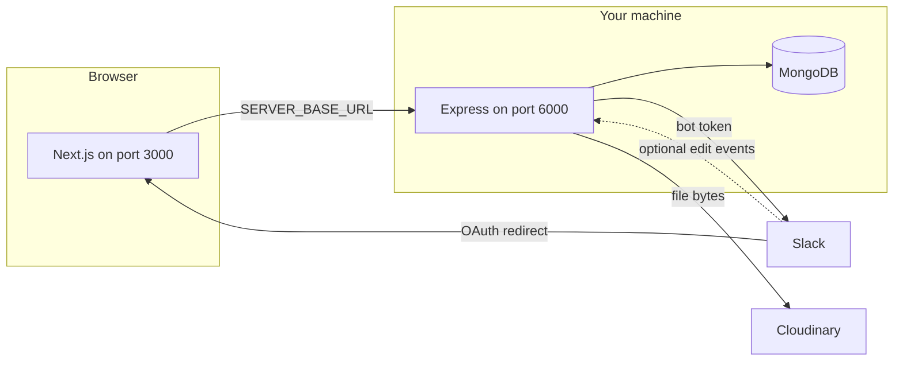
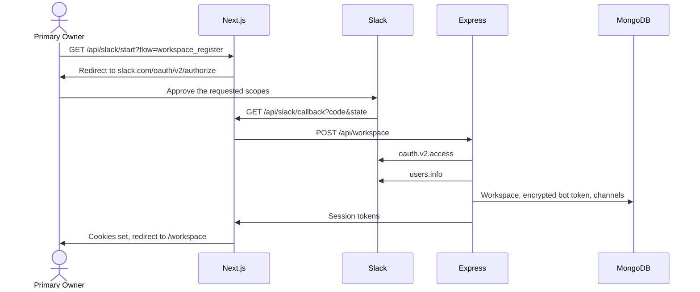
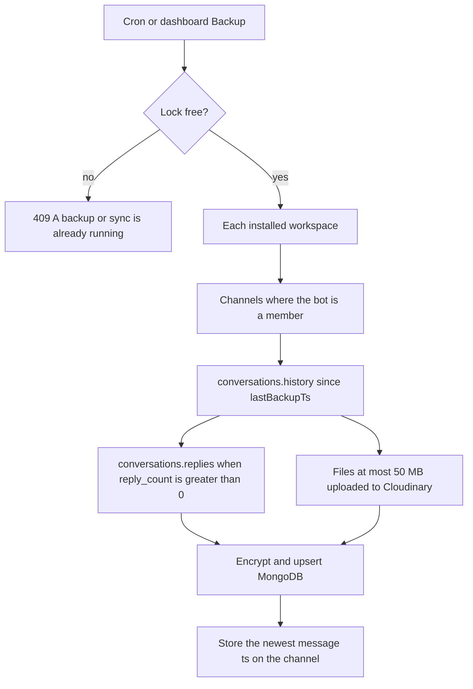

<div align="center">

# Keeprithm

Self-hosted archive for a Slack workspace. It pulls channel history and thread replies into MongoDB you run, stores file bytes in your Cloudinary account, and gives the workspace a Slack-like UI to read and search what was saved.

[](LICENSE)
[](https://nodejs.org/)

[Setup](#run-it-locally) · [Contributing](CONTRIBUTING.md) · [License](LICENSE)

Built by **[Blockrithms](https://blockrithms.com/?utm_source=github&utm_medium=readme&utm_campaign=keeprithm&utm_content=header)**

</div>

Slack’s free plan hides messages older than 90 days. Keeprithm keeps copying what Slack still returns, so the copy on your server outlives that window. The first backup can only include history Slack is still willing to send.

There is no hosted Keeprithm service in this repository. Signing in, installing a workspace, and reading the archive all happen on the instance you start.

## What you get

- Incremental backup of channel messages, using each channel’s last saved timestamp as the Slack `oldest` cursor
- Thread replies, stored separately and shown in a thread panel
- A channel browser, message permalinks, and search over the archive
- File attachments up to 50 MB, uploaded to your Cloudinary account under the folder `slack_backup`
- Sign in with Slack (OpenID Connect) for workspace members
- One email-and-password operator account for the admin dashboard
- Admin dashboard: archive counts, MongoDB size of messages and threads, per-workspace backup freshness, channel sync, manual backup, and the ability to block a user
- Encryption at rest for bot tokens, member Slack tokens, message and reply bodies, sender names, mentions, files, and reactions

## Limits

- A channel is archived only after the bot has been invited to it. Private channels need that invite as well.
- The installer must be the Slack **Primary Owner** of the workspace (`is_primary_owner`), not only a workspace admin.
- One backup or channel sync runs at a time, and the lock lives in the API process memory. Run a single API process. A restart clears the lock.
- `conversations.history` is a Slack Tier 3 method (about 50 requests per minute). The backup waits 2 seconds between channels and pages history 200 messages at a time.
- Files larger than 50 MB are skipped. The dashboard size figure is MongoDB storage for messages and threads, including indexes. It does not include Cloudinary bytes.
- Search indexes word prefixes (2–12 characters, up to 80 words) with an HMAC. It is not Slack’s search syntax, and it does not stem words.
- An edit is applied when Slack posts a `message_changed` event to your API. Deletes in Slack are left as they were in the archive.
- The scheduled backup runs only while the API process is up.

## How it fits together

The browser talks only to the Next.js app. Next.js stores the session cookies and calls the Express API. The API holds the Slack bot token and talks to Slack and Cloudinary.



Workspace install:



Backup:



There is no `SLACK_BOT_TOKEN` in the environment. The bot token is obtained during install and stored encrypted on the workspace document. Pasting a token into `.env` does not install a workspace.

## Repository layout

| Path | Role |
| --- | --- |
| `client/` | Next.js 16 App Router UI. Dev server on port 3000. |
| `server/` | Express API, cron, and scripts. Dev server on port 6000. |
| `slack-manifest.json` | Slack app manifest. Paste it when creating the app. |
| `server/src/config/config.js` | Loads `server/.env` and refuses to boot if a required variable is missing or the encryption key is not 64 hex characters. |
| `server/scripts/` | Admin seed, encryption migration, Slack history rate-limit probe. |
| `.env.example` | Published ports for Docker Compose only. `yarn dev` ignores it. |

Package manager is **Yarn Classic 1.22**. The root `package.json` declares `client` and `server` workspaces, and the lockfile is Yarn v1. Node.js **22** is the version the Dockerfiles use and the version this setup expects. Next.js 16 requires Node 20.9 or newer.

## External services

You need three accounts before the API will do useful work. The API process also refuses to start until every required variable below is present.

### Slack app

Create the app in the workspace you want to archive. An undistributed Slack app can only be installed on the workspace where it was created. For a second workspace, create another app there, or turn on Slack distribution.

1. Open <https://api.slack.com/apps> and choose **Create New App** → **From a manifest**. Pick the target workspace and paste [`slack-manifest.json`](slack-manifest.json). That names the bot Keeprithm, so the invite command is `/invite @keeprithm`, and it registers the redirect URL and the scopes below.
2. The redirect URL in the manifest is:

   ```text
   http://localhost:3000/api/slack/callback
   ```

   For a tunnel or a real host, replace the origin and keep the path `/api/slack/callback`. No trailing slash. The origin must equal `APP_URL` in `client/.env`. Change it under **OAuth & Permissions**, and again under **Sign in with Slack** if that list is empty.
3. The manifest requests these **Bot Token Scopes**. The install URL asks for the same set unless `SLACK_BOT_SCOPES` overrides it on the client:

   | Scope | Why |
   | --- | --- |
   | `channels:history` | Read public channel messages |
   | `channels:read` | List public channels |
   | `groups:history` | Read private channel messages |
   | `groups:read` | List private channels the bot can see |
   | `files:read` | Download files Slack still exposes to the bot |
   | `users:read` | Resolve sender names, and check `is_primary_owner` |
   | `team:read` | Workspace identity |
   | `chat:write` | Post the optional backup summary |

4. The manifest also requests user scopes `openid`, `email`, and `profile`. Members sign in with those. The install URL sends them as `user_scope`.
5. Open **Sign in with Slack** and confirm the redirect URL from step 2 is listed there too.
6. **Basic Information**. Copy **Client ID**, **Client Secret**, and **Signing Secret**.
   - Client ID goes in both `client/.env` and `server/.env`.
   - Client Secret and Signing Secret go in `server/.env` only.
7. Optional, for live edits: **Event Subscriptions**. The manifest leaves this out, because Slack rejects event subscriptions until the request URL is a public HTTPS address it can verify. Set the request URL to:

   ```text
   https://YOUR_PUBLIC_API_ORIGIN/api/slack-events
   ```

   Subscribe to the `message` bot event for public and private channels. The handler answers Slack’s URL verification challenge and applies `message_changed` onto a message that is already stored. The API must be reachable by Slack over HTTPS. A localhost-only API still backs up on the cron and from the dashboard; it just will not see edits until the events URL is public. The signing secret must be the one from step 6.

Do not use **Install App** on the Slack dashboard as a substitute for the install URL below. That button never writes the bot token into MongoDB.

### Cloudinary

File bytes are uploaded with the Cloudinary Node SDK (`upload_stream`) using the account API key. No upload preset is required.

1. Create a free account at <https://cloudinary.com/>.
2. On the dashboard, copy **Cloud name**, **API Key**, and **API Secret** into `server/.env` as `CLOUDINARY_CLOUD_NAME`, `CLOUDINARY_API_KEY`, and `CLOUDINARY_API_SECRET`.
3. Uploads land in the folder `slack_backup`. The MongoDB document keeps the secure URL and public id, then encrypts that metadata with the rest of the file field.

The API requires the three variables to be set (an empty string passes the boot check). File backup fails until they are real credentials. Message text can still be stored when an upload fails; that file is omitted from the message.

### MongoDB

Local development expects MongoDB listening on `127.0.0.1:27017` without authentication, database name `keeprithm`. MongoDB 7 or 8 is fine. The server Dockerfile and Compose file pin the image `mongo:8.0.4` for the container path.

```bash
docker run -d --name keeprithm-mongo --restart unless-stopped -p 27017:27017 mongo:8
```

On startup the API connects, then runs `syncIndexes()` for users, workspaces, messages, threads, and tokens.

### Mail

SMTP variables are optional. Password reset and email-verification messages use them. Sign-in, workspace install, and backup do not. The placeholders in `server/.env.example` let the process start; those emails will fail until you point them at a real SMTP server.

## Configure

Generate secrets before the first install. Keep `ENCRYPTION_KEY` forever. Message text and bot tokens written with it cannot be decrypted with a different key, and this repo has no key-rotation command.

```bash
node -e "console.log(require('crypto').randomBytes(32).toString('hex'))"   # ENCRYPTION_KEY
node -e "console.log(require('crypto').randomBytes(32).toString('hex'))"   # JWT_SECRET
```

From the repository root:

```bash
cp server/.env.example server/.env
cp client/.env.example client/.env
```

Then replace the empty Slack and Cloudinary values and replace `JWT_SECRET` and `ENCRYPTION_KEY`. Do not commit either `.env`.

`server/.env` after a local edit looks like this. Slack API URLs are fixed; copy them as written. `SLACK_CLIENT_ID` must be the same value in both env files.

```bash
NODE_ENV=development
PORT=6000
MONGODB_URL=mongodb://127.0.0.1:27017/keeprithm

JWT_SECRET=replace-with-64-hex-or-another-long-random-string
JWT_ACCESS_EXPIRATION_MINUTES=30
JWT_REFRESH_EXPIRATION_DAYS=30
JWT_RESET_PASSWORD_EXPIRATION_MINUTES=10
JWT_VERIFY_EMAIL_EXPIRATION_MINUTES=10

# Optional. Leave the example placeholders if you are not sending mail.
SMTP_HOST=email-server
SMTP_PORT=587
SMTP_USERNAME=email-server-username
SMTP_PASSWORD=email-server-password
EMAIL_FROM=support@yourapp.com

FRONTEND_URL=http://localhost:3000
BACKEND_URL=http://localhost:6000

SLACK_CLIENT_ID=paste-client-id
SLACK_CLIENT_SECRET=paste-client-secret
SLACK_SIGNING_SECRET=paste-signing-secret

SLACK_OAUTH_AUTHORIZE_URL=https://slack.com/oauth/v2/authorize
SLACK_OAUTH_TOKEN_EXCHANGE_URL=https://slack.com/api/oauth.v2.access
SLACK_OAUTH_TOKEN_VALIDATION_URL=https://slack.com/api/auth.test
SLACK_OPENID_AUTHORIZE_URL=https://slack.com/openid/connect/authorize
SLACK_OPENID_TOKEN_EXCHANGE_URL=https://slack.com/api/openid.connect.token
SLACK_OPENID_USER_INFO_URL=https://slack.com/api/openid.connect.userInfo
SLACK_USER_INFO_URL=https://slack.com/api/users.info
SLACK_USER_LIST_URL=https://slack.com/api/users.list
SLACK_CHANNEL_INFO_URL=https://slack.com/api/conversations.info
SLACK_CHANNEL_MEMBERS_URL=https://slack.com/api/conversations.members
SLACK_CHANNEL_LIST_URL=https://slack.com/api/conversations.list?types=public_channel,private_channel
SLACK_CHANNEL_HISTORY_URL=https://slack.com/api/conversations.history
SLACK_CHANNEL_REPLIES_URL=https://slack.com/api/conversations.replies
SLACK_WORKSPACE_INFO_URL=https://slack.com/api/team.info
SLACK_CHAT_POST_MESSAGE_URL=https://slack.com/api/chat.postMessage

SLACK_BACKUP_CRON_JOB_PATTERN=0 * * * *

CLOUDINARY_CLOUD_NAME=paste-cloud-name
CLOUDINARY_API_KEY=paste-api-key
CLOUDINARY_API_SECRET=paste-api-secret

ENCRYPTION_KEY=paste-64-hex-chars

# Optional. Comma-separated Slack team ids (T...). Empty means any workspace
# that can complete this app's OAuth install is accepted.
# SLACK_ALLOWED_TEAM_IDS=T01234567
```

`client/.env`:

```bash
NODE_ENV=development
PORT=3000
APP_URL=http://localhost:3000
SERVER_BASE_URL=http://localhost:6000/api
COOKIE_SECURE=false

SLACK_CLIENT_ID=paste-client-id
SLACK_OPENID_AUTHORIZE_URL=https://slack.com/openid/connect/authorize
SLACK_OAUTH_AUTHORIZE_URL=https://slack.com/oauth/v2/authorize
# SLACK_BOT_SCOPES=channels:history,channels:read,groups:read,groups:history,files:read,users:read,team:read,chat:write
```

`SERVER_BASE_URL` must include the `/api` suffix and must use the same port as `PORT` in `server/.env`. `APP_URL` is the origin Slack redirects to. `FRONTEND_URL` should be that same origin; production CORS allows only `FRONTEND_URL`.

### HTTPS tunnel

Use this when you want Secure cookies, or when Slack must reach the events endpoint. Point a tunnel (ngrok, VS Code dev tunnels, or similar) at port 3000. Then:

- Set `APP_URL` and `FRONTEND_URL` to the tunnel origin, with no trailing slash.
- Add `https://TUNNEL/api/slack/callback` to both Slack redirect lists.
- Remove `COOKIE_SECURE` or set it to `true`.
- Open the app at the tunnel URL, not at `http://localhost:3000`. The start route sends you to `APP_URL` once so the OAuth state cookie and Slack’s redirect share a host.

If the events URL is a second public hostname, that hostname must reach the API port, and `SLACK_SIGNING_SECRET` must match the app.

### Variable reference

| Variable | Required to boot | Where | Purpose |
| --- | --- | --- | --- |
| `NODE_ENV` | yes | server, client | `development`, `production`, or `test`. Production enables the auth rate limit. |
| `PORT` | server defaults to 3000 | both | Local setup uses **6000** on the server and **3000** on the client. |
| `MONGODB_URL` | yes | server | Mongo connection string. |
| `JWT_SECRET` | yes | server | Signs access tokens. Access token lifetime defaults to 30 minutes. Refresh tokens last 30 days. |
| `FRONTEND_URL` | yes | server | Browser origin. Production CORS origin. Fallback OAuth redirect base. |
| `BACKEND_URL` | no | server | Public API origin when you have one. |
| `SLACK_CLIENT_ID` | yes | both | Slack app client id. |
| `SLACK_CLIENT_SECRET` | yes | server | Exchanges the OAuth code. |
| `SLACK_SIGNING_SECRET` | yes | server | Verifies `POST /api/slack-events`. |
| `SLACK_*_URL` | yes | server | Slack endpoints. Use the values from the example. |
| `SLACK_BACKUP_CRON_JOB_PATTERN` | yes | server | Five-field cron in the server’s local timezone. `0 * * * *` is hourly. |
| `CLOUDINARY_CLOUD_NAME` | yes | server | Cloudinary cloud name. |
| `CLOUDINARY_API_KEY` | yes | server | Cloudinary API key. |
| `CLOUDINARY_API_SECRET` | yes | server | Cloudinary API secret. |
| `ENCRYPTION_KEY` | yes | server | 64 hex characters. HKDF splits it into an AES-256-GCM key and a search HMAC key. |
| `SLACK_ALLOWED_TEAM_IDS` | no | server | Comma-separated team ids allowed to install. |
| `APP_URL` | client OAuth | client | Public origin for the OAuth redirect and the state cookie. |
| `SERVER_BASE_URL` | client API calls | client | API base, including `/api`. |
| `COOKIE_SECURE` | no | client | `false` for `http://localhost`. Otherwise cookies are `Secure`. |
| `SLACK_BOT_SCOPES` | no | client | Overrides the bot scopes requested at install time. The Slack app must allow every scope in the list. |
| SMTP / `EMAIL_FROM` | no | server | Password reset and address verification only. |

A missing required server variable throws `Config validation error: "NAME" is required` and the process exits. A bad `ENCRYPTION_KEY` throws because it must match `^[0-9a-fA-F]{64}$`.

## Run it locally

These steps assume a Unix shell, Node 22, and Docker only for the MongoDB container. A human must create the Slack app, the Cloudinary account, and complete the browser install. Everything else can be done from the terminal.

1. Install Yarn Classic if `yarn --version` is not 1.x:

   ```bash
   corepack enable
   corepack prepare yarn@1.22.22 --activate
   ```

2. Start MongoDB (see the MongoDB section) and confirm it accepts connections:

   ```bash
   docker exec keeprithm-mongo mongosh --quiet --eval 'db.runCommand({ ping: 1 }).ok'
   ```

   Expected output: `1`.

3. Install dependencies from the repository root:

   ```bash
   yarn install
   ```

4. Write `server/.env` and `client/.env` as in [Configure](#configure). Confirm the ports agree:

   ```bash
   grep -E '^(PORT|FRONTEND_URL)=' server/.env
   grep -E '^(APP_URL|SERVER_BASE_URL|COOKIE_SECURE)=' client/.env
   ```

   Expected for this local layout:

   ```text
   PORT=6000
   FRONTEND_URL=http://localhost:3000
   APP_URL=http://localhost:3000
   SERVER_BASE_URL=http://localhost:6000/api
   COOKIE_SECURE=false
   ```

5. Start both processes:

   ```bash
   yarn dev
   ```

   Wait until the API logs `Connected to MongoDB` and `Listening to port 6000`, and Next.js is ready on port 3000. Leave this running.

6. In another terminal, check both listeners:

   ```bash
   curl -s -o /dev/null -w 'api %{http_code}\n' \
     -X POST http://localhost:6000/api/auth/login \
     -H 'content-type: application/json' \
     -d '{}'
   curl -s -o /dev/null -w 'web %{http_code}\n' http://localhost:3000/login
   ```

   Expected: `api 400` (the route exists; the body failed validation) and `web 200`. `000` means that process is not up. A config error is printed by the API process and it will not listen.

7. Create the operator account. The password must be at least 8 characters and contain a letter and a number. This script deletes any existing `role: admin` user and creates one named `Exporter Admin`.

   ```bash
   printf 'admin@example.com\nChangeMe123\n' | yarn --cwd server seed:admin
   ```

   Expected log: `Admin user created successfully!`

8. Confirm the password login against the API:

   ```bash
   curl -s -o /dev/null -w '%{http_code}\n' \
     -X POST http://localhost:6000/api/auth/login \
     -H 'content-type: application/json' \
     -d '{"email":"admin@example.com","password":"ChangeMe123"}'
   ```

   Expected: `200`. Then open <http://localhost:3000/login>, sign in with that email and password, and land on `/dashboard`.

Stop here until a human finishes the Slack install in the next section. The dashboard stays empty of workspaces until that install succeeds.

## Install a workspace

**HUMAN.** The Primary Owner of the Slack workspace opens this URL in a browser (use the tunnel origin when `APP_URL` is a tunnel):

```text
http://localhost:3000/api/slack/start?flow=workspace_register
```

Slack shows a consent screen. After approval the browser returns to `/workspace` with a session cookie. If the signed-in Slack user is not the Primary Owner, the login page shows “Only the Primary Workspace Owner can install a Slack workspace.” A team id outside `SLACK_ALLOWED_TEAM_IDS` shows “This Slack workspace is not permitted on this deployment.”

Members later use **Sign in with Slack** on `/login`, which starts `/api/slack/start?flow=signin`. The public `/register` page is disabled.

In Slack, invite the bot to every channel you want archived (`/invite @YourBotName`). Private channels stay invisible until the bot is a member.

Back on the dashboard as the operator:

1. **Sync** on that workspace. This refreshes channels and membership from Slack and records whether the bot is in each channel.
2. **Backup** on that workspace. This pulls history and replies for channels the bot has joined.

The buttons stay disabled until that job finishes. A second click while one is running returns HTTP 409. The hourly cron calls the same backup for every workspace.

After a backup, a member who has signed in with Slack can open `/workspace`, pick a channel the bot is in and that they belong to, and search from the search box (Ctrl+K).

## Encryption

Fields that the UI must read back go through AES-256-GCM. The stored form is `enc:v1:` plus base64 of `iv || auth tag || ciphertext`. A separate HMAC key, derived from the same master key, builds the search index. Passwords stay bcrypt. User names, emails, and channel names are stored in plaintext.

If this database already contains rows from before encryption existed, dry-run the migration first. It writes nothing, checks that any existing ciphertext opens with the current key, and prints how many documents would change.

```bash
yarn migrate:encrypt:dry
yarn migrate:encrypt
```

Run `yarn migrate:encrypt` with the production `ENCRYPTION_KEY` while a backup is not writing. It is safe to run again: already-encrypted values are skipped, and a key that cannot open existing ciphertext stops the script before it writes.

## Scripts

| Command | What it does |
| --- | --- |
| `yarn dev` | Next.js and the API together. |
| `yarn --cwd server seed:admin` | Interactive admin seed. Replaces the current admin. |
| `yarn migrate:encrypt:dry` | Report what an encryption pass would change. |
| `yarn migrate:encrypt` | Encrypt leftover plaintext rows. |
| `yarn debug:history-limit` | One `conversations.history` call with `limit=1`. Prints HTTP status, the Slack error, and rate-limit headers. Does not print message text. |
| `yarn debug:history-limit -- --workspace T... --channel C... --burst 10` | Repeat that call until Slack returns 429 or 10 requests, whichever comes first. This spends the workspace history budget. Do not run it during a backup. |

## Production

Run one API process and one Next.js process behind HTTPS.

- API: from `server/`, `NODE_ENV=production yarn start` (PM2, `src/index.js`). Set `PORT` to the port your proxy or container targets.
- Web: from `client/`, `yarn build` then `yarn start`. Put TLS in front of it. Set `APP_URL` and `FRONTEND_URL` to that public origin.
- `SERVER_BASE_URL` is called by the Next.js server, so it can be a private address such as `http://127.0.0.1:6000/api`.
- Put the Slack redirect URL on that public web origin.
- Put a long random `JWT_SECRET` and a backed-up `ENCRYPTION_KEY` in the server environment. Never commit them.
- In production, failed requests to `/api/auth` are limited to 20 per 15 minutes per IP. Successful logins are not counted.
- MongoDB should require authentication and should not be published to the internet. Put that URL in `MONGODB_URL`.
- Prefer a private network path from the API to Cloudinary over embedding the archive in a public Cloudinary folder without access control. The secure URLs stored with each file are only as private as the Cloudinary account settings you choose.

### Docker Compose

`docker-compose.yml` is a sketch, not the supported install. It expects a root `.env` (`CLIENT_PORT`, `SERVER_PORT`, `DATABASE_USER`, `DATABASE_PASSWORD`, `DATABASE_PORT`) plus `server/.env.production` and `client/.env.production`, which are not in git. The API container publishes port 3000, so `PORT` inside `server/.env.production` must be `3000`. The web service publishes container port 4000, while `client/Dockerfile` sets `PORT=3000`, and that image runs `npm ci` against a `client/package-lock.json` this repo does not contain. Use the [local steps](#run-it-locally) until those images are rebuilt to match.

## Privacy

Messages move between Slack, the API you run, MongoDB you run, and the Cloudinary account whose keys are in your env. Blockrithms does not receive them because you ran this software. You still need to keep `ENCRYPTION_KEY`, `JWT_SECRET`, the Slack client secret, the signing secret, and the Cloudinary secret off the disk you commit, and you need a retention policy that matches your own rules.

## Troubleshooting

| What you see | What to change |
| --- | --- |
| `Config validation error` | The quoted variable is missing or `ENCRYPTION_KEY` is not 64 hex characters. The API will not listen. |
| `api 000` from curl | MongoDB is down, or the API crashed on startup. Read the `yarn dev` log. |
| Login page `slack_misconfigured` | `SLACK_CLIENT_ID` is empty in `client/.env`. Restart Next.js after changing it. |
| `state_mismatch` | The OAuth cookie was set on a different host than Slack redirected to. Open the app on `APP_URL`. |
| `redirect_uri did not match` from Slack | The redirect URL in the Slack app must equal `${APP_URL}/api/slack/callback` with no trailing slash, on both the OAuth page and the OpenID page. |
| Primary Owner error | The Slack user who approved the install is not `is_primary_owner`. |
| Backup finishes and a channel is still empty | The bot is not in that channel, or Sync has not been run since the invite. |
| Buttons stay on “Syncing…” or “Backing up…” across a restart | The lock died with the process. Load the dashboard again; a new load reads `running: false`. |
| Search misses a word you can see | The index stores prefixes of words that are at least 2 characters, capped at 80 words per message. |
| Files missing, text present | The file was over 50 MB, or Cloudinary rejected the upload. The API log says `File upload failed` or `Skipping large file`. |
| Edits in Slack never show up | The events request URL is not reaching `POST /api/slack-events`, or the signing secret does not match. History backup does not re-fetch a message it already stored. |

## Contributing

Setup lives in this README. The review bar, code map, and the few things that must not change are in [CONTRIBUTING.md](CONTRIBUTING.md). Lint the workspace you touched before you open a pull request.

## License

[MIT](LICENSE). Copyright © 2026 Blockrithms.

Keeprithm is an independent project. It is not affiliated with, endorsed by, or sponsored by Slack Technologies, LLC or Salesforce. Slack is a trademark of Slack Technologies, LLC.

## Support

Blockrithms can deploy and run this on your infrastructure. Write to **info@blockrithms.com** or use the contact page on your own instance at `/contact`.
